# Stremio Kai for Tizen (FeridunDuran fork)

Stremio for Samsung Tizen TVs, including older models (2017 and newer, Tizen 3.0+) that can't
run the official Stremio app. It runs as a [TizenBrew](https://github.com/reisxd/TizenBrew)
app module with the [Stremio Kai](https://github.com/allecsc/Stremio-Kai) look, fully
controlled with the Samsung remote.

This is a fork of [ITzAkai/kai](https://github.com/ITzAkai/kai). It follows upstream and adds
its own fixes and features, listed below. The app loads and updates itself from **this**
repository.

> **Unofficial.** Not affiliated with Stremio, Stremio Kai or Samsung. The app hosts no
> content: it only shows what the add-ons on **your** Stremio account provide.

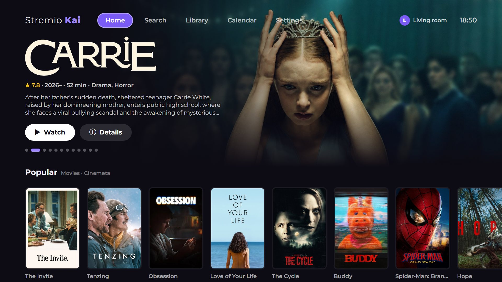

## What this fork adds

### Continue watching keeps your series
Upstream dropped a series from **Continue watching** as soon as you finished an episode. This
fork follows the official Stremio logic (stremio-core):
- When you leave an episode after 90% of it, the series moves on to the **next episode** and
  stays in the row, ready to play.
- Like Stremio, it doesn't jump from a regular season into specials (season 0) and skips
  episodes that haven't been released yet.
- A film, or the last episode of a series, leaves the row when finished.
- Progress saved on your phone or PC shows up as soon as the app starts, without switching tabs.

### Library sorting
A **Sort** button next to All / Movies / Series, remembered per profile:
- Last watched (default, as in Stremio), Recently added
- Name A-Z, Name Z-A, Most watched
- Release date (newest / oldest) and Rating (IMDb, highest)

Library items don't carry release dates or ratings, so the first time you pick those sorts the
app fetches them from your add-ons (two at a time, to spare the TV's memory) and keeps them on
the TV. Titles without the information go last.

### Home screen rows
**Settings → Add-ons → Home screen rows** lists every catalog row. Pick one to move it up, down,
to the top or the bottom, or to hide it. It works per profile and only changes this app, not
your Stremio account. Rows from a newly added add-on appear at the bottom; **Reset to add-on
order** brings back the default.

Without this, rows follow the order of the add-ons on your account (the newest add-on last),
which you can also change at web.stremio.com → Add-ons.

### Only sources the TV can play
Torrents play on the TV through its built-in engine and rolling RAM cache. Torrent playback does
not use a PC server. If the TV engine is unavailable, torrent sources are hidden with a count per
add-on.

Torrent discovery uses UDP/DHT and HTTP trackers in parallel. **Ready** means the engine is
available, not that a particular source has reachable peers. Metadata retrieval has a 20-second
inactivity deadline that resets when new metadata blocks arrive. Video reads also stop after
20 seconds without incoming torrent data; active transfers can continue beyond that time.
Errors distinguish peer discovery, handshake, metadata, missing video data and playback failures.
After a player service update, fully restart the TV so TizenBrew replaces the old service.

The TV keeps a moving window of torrent pieces in memory instead of saving the whole video to
internal storage. Seeking outside that window fetches the needed pieces again.

Links that need extra request headers (Referer, User-Agent, Cookie...) work without a PC: the
app's small TizenBrew service on the TV fetches them and adds the headers, so the player gets a
normal local URL. They are tagged **Via TV**. If the TV service is not running they show as
**Direct · may fail**, the player tries them directly, and Smart Choice puts them last.

### Source browsing and ordering
Sources have type filters and collapsed add-on groups. Within each add-on, HTTP sources are
ordered by reported resolution, highest first. Torrents are ordered by reported seed count,
highest first; unknown counts come last. Reported seed counts are hints from the add-on, not
live checks that a torrent will play.

### Faster torrent startup
The TV prioritizes the requested playback position, prefetches and retains MP4 header pieces,
and adjusts peer request queues to their throughput. Switching episodes within the same torrent
preserves its peer connections. The verified-piece cache is bounded to 48 MiB.

A Joy HEVC/AAC episode was confirmed playing with picture and sound on the Q70T. A later cold
start reached the player’s enough-data state in about 10 seconds; startup depends on the swarm,
file and resume position, so this is an observation rather than a guaranteed loading time.
Implementation and local test details: [Torrent startup](docs/torrent-startup.md).

### Safer next-episode playback
At the credits, or 25 seconds before the end when credits are unknown, a 10-second countdown
offers the next episode. Pausing pauses the countdown; seeking away cancels the active countdown.
Cancel or Back keeps the current episode. Unreleased episodes and a jump from regular seasons
to specials are excluded.

The player prefers a source in the same torrent, then a matching binge group from the same
add-on. It can start as soon as a matching add-on responds. If no match exists, it opens the
next episode’s source list. Duplicate transition requests are blocked, and the previous episode’s
fallback sources and delayed playback actions cannot carry over to the next episode.
These transition cases pass local integration tests; TV automatic-transition verification is pending.

The next episode's add-on sources are requested about a minute before the up-next point (as
stremio-core requests next-episode streams in advance), so the countdown or the Next button
usually does not wait for add-ons. Lookups older than ten minutes are not reused, because HTTP
links can expire. Only add-on lists are prefetched; no next-episode torrent data is downloaded.
After the player moves to another episode, Back from the player shows that episode in the
episode list instead of the previous episode's sources.

### Shorter waits before playback
- A source list requests every add-on immediately; service discovery (PC server check, TV player
  service launch) runs at the same time instead of first. Torrent rows still appear only after
  the TV engine state is known.
- The home screen no longer waits for the PC server or TV player service checks at startup.
- Chromium starts autoplay only at its "enough data" state; with its spec-compliant
  can-play-through feature, that state also depends on a download-rate estimate covering the rest
  of the file. A slow torrent can already have playable data before that. The player now starts
  playback as soon as the browser reports that it can play (`canplay`), unless you paused it
  during loading. Whether the TV's browser engine behaves this way is not yet measured.
- Peer request queues now grow with long round trips (three seconds of measured rate plus two
  blocks, at most 64 per peer, as in WebTorrent/libtorrent). Before, a peer with more than 0.75 s
  round trip was held at 32 KiB per round trip. The 4 MiB engine-wide request cap is unchanged.
  This changes the TV player service: fully restart the TV after updating.
- For MP4 files the piece read just before the jump to the index at the end of the file stays
  in RAM in one reserved cache slot. The TV re-read it right after the jump and previously had
  to download those 4 MiB again (about 2-5 s in two TV traces).
- When playback will resume more than two minutes into the file, the TV downloads only the
  pieces the player actually reads at the start and end of the file (header and index) until
  the resume position is read. Before, it also downloaded 32 MiB of read-ahead from the start of
  the file that resumed playback never used.
- Peers that actually delivered data for a torrent are remembered in the app's own storage
  (20 torrents, 30 peers each) and offered to the TV engine as connection hints the next time the
  same torrent opens, as libtorrent does with the peers in its resume data. Discovery through
  trackers/DHT still runs in parallel. Peer addresses are never written to the remote log.
- A peer may hold at most two seconds of its measured rate in blocks of the piece being played
  (as libtorrent does for time-critical pieces); the rest of its queue serves read-ahead.
- A slow torrent that is still receiving data is treated as buffering, not as a stalled stream,
  so the player no longer reopens it (and throws away its buffer) after 15 seconds.
Piece verification and the 48 MiB cache limit are unchanged. These are code-path changes with
local tests; their effect on TV startup time has not been measured yet.

### While loading and watching
- The loading screen names the step actually in progress, with the total wait since the start: starting the TV torrent player,
  getting the torrent file list, waiting for video data from peers, reading the video
  information, jumping to the resume position, buffering, finding the next episode. For torrents
  a small line shows connected peers, data received and the current download rate, plus a note
  when the download is slower than the file's average bitrate. There are no estimated percentages.
- While the player controls are visible, a small line in the top-right corner shows connected
  peers, current download rate, "needs ~X MB/s" (the file's average bitrate) and the video height. It is hidden during full-screen viewing; **Hide stats / Show stats** turns it off or on
  (remembered). The average bitrate is not a minimum: scenes vary, so playback can keep up at a
  lower download rate.
- With the remote log on, torrent playback logs a compact service state every 3 s while starting
  and every 10 s while playing (connections, unchoked peers, top peer rates, discovery times,
  connection lifetimes, request-to-verify time of recent pieces, window and scheduler counters),
  each rebuffer's start state and duration, and a playback summary when the player closes.
- Each start logs a startup timeline (milliseconds to URL, metadata, seek, first frame,
  `canplay`, `canplaythrough`, playing) to the remote log when it is enabled.
- After an error the Play button becomes **Try again** (same source, from the last position that
  played); Sources stays next to it. Errors that do not establish a codec problem no longer
  suggest choosing a different codec.
- Once a video has loaded (playing or paused), Back first asks for a second press; a second Back
  within three seconds leaves. A held key or a duplicate of the same press (within 350 ms) does
  not count. Loading or failed playback leaves with one press. Stop always leaves.

### Other changes
- The loader and in-app updater point to this repository, so the TV runs this fork's code.
- English is the default language; Samsung on-screen keyboard Done / Cancel work in text fields.

## Features from upstream

#### A home screen built for the TV
Rotating hero banner with the title's logo, rating, runtime and genres, and **Watch** /
**Details** one press away. Below it, every catalog from your Stremio add-ons as a row.

#### See all, without dead ends
Every row ends in a **See all** tile that opens the whole catalog as a grid. More titles load
on their own as you scroll down, so you never hit the end of a list.

| Row end | Full catalog |
|---|---|
| 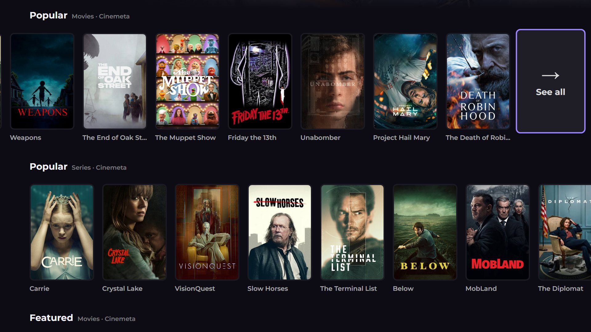 | 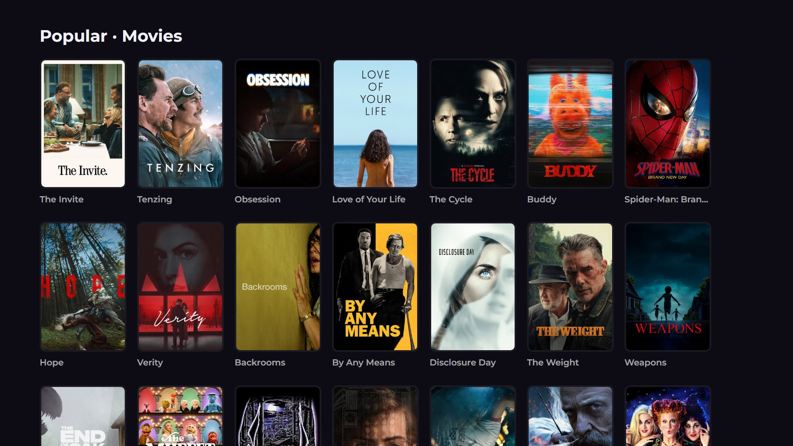 |

#### Smart Choice
Press **Watch** and the app picks the best source and starts playing, no source list to scroll
through. It prefers direct (debrid) links, your add-ons' order, and files the TV plays well,
skipping Dolby Vision, REMUX and very high bitrates when there's anything else. If a source won't
start, it moves on to the next best one. **Sources** still shows the full list.

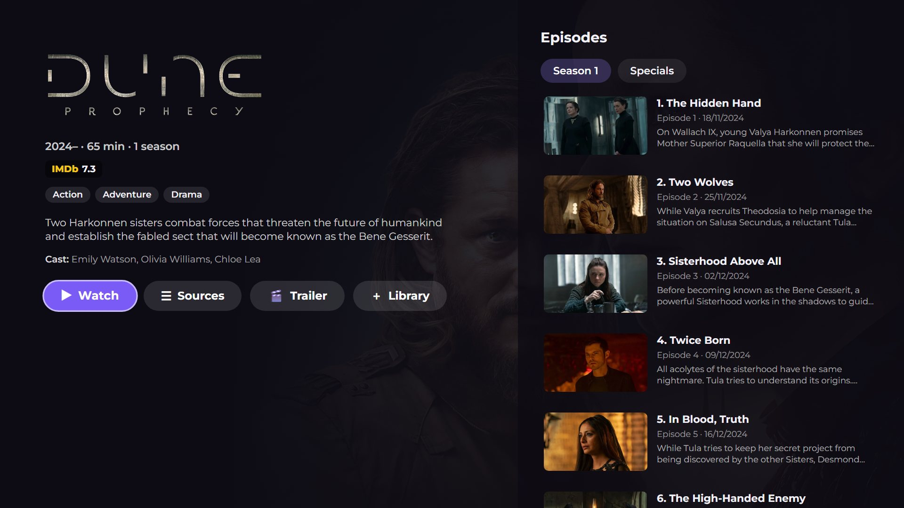

#### Phone remote
Use your phone as the remote, no app to install. Scan the QR code in **Settings → Phone remote**
and your phone's browser opens a remote with a D-pad, OK, Back and playback buttons, subtitle
sync and volume buttons, a **Now playing** card (poster, title and a progress bar you can drag
to jump anywhere), **Search on the TV** (type, or speak with your keyboard's 🎤: the TV jumps to Search
from any screen), and a text box that types straight into the TV's search or sign-in fields. A PIN shown on the TV keeps
others on your Wi-Fi out. It runs as a small TizenBrew service on the TV, nothing leaves your
home network.

| On your phone | On the TV (Settings) |
|---|---|
| 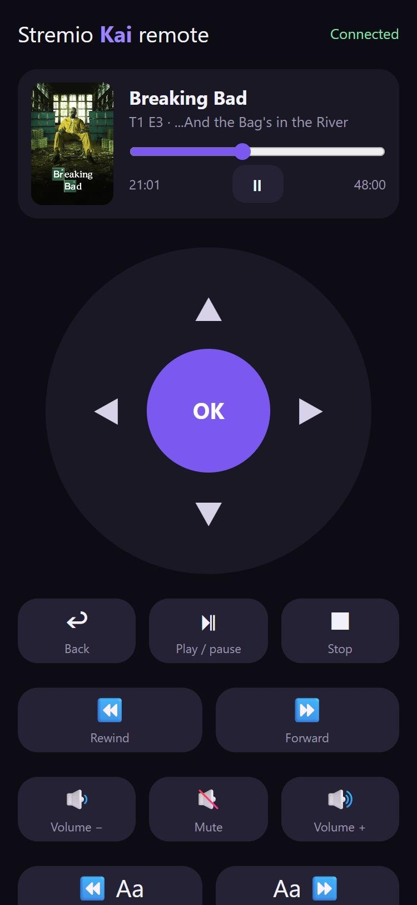 |  |

**Browse on the phone:** the **Browse** tab shows your Continue watching, New episodes and
Library as posters; tap one and it opens on the TV, ready on that episode.

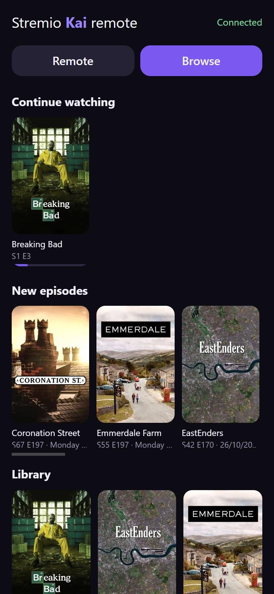

#### Search across all your add-ons
Results from every add-on that supports search, grouped by movies and series.

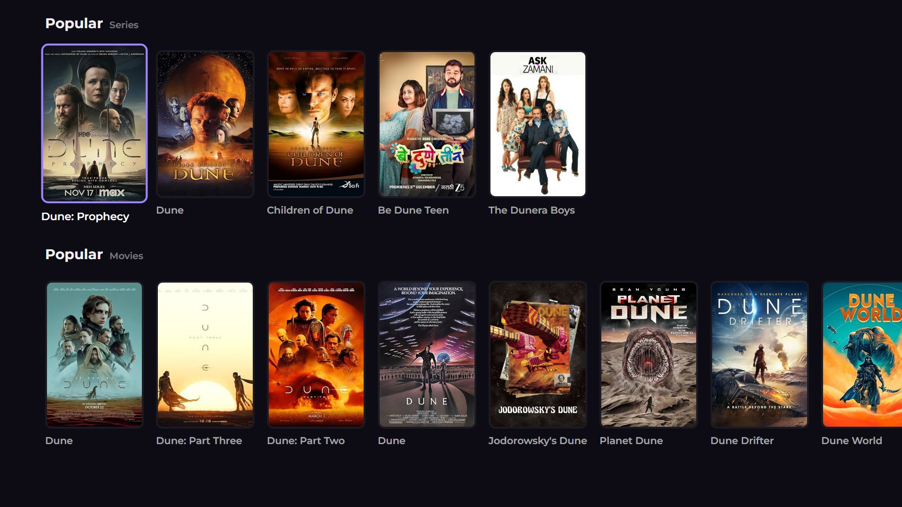

#### Release calendar: anime, series and movies
A week at a time, day by day:
- **Anime:** every episode airing that day, including Chinese and Korean titles, with air
  time, episode and score.
- **Series:** new episodes from streaming services worldwide and US TV, with the network.
- **Movies:** the day each film becomes available to stream at home (with a free
  [TMDB](https://www.themoviedb.org/settings/api) key in Settings).

| Anime | Series |
|---|---|
| 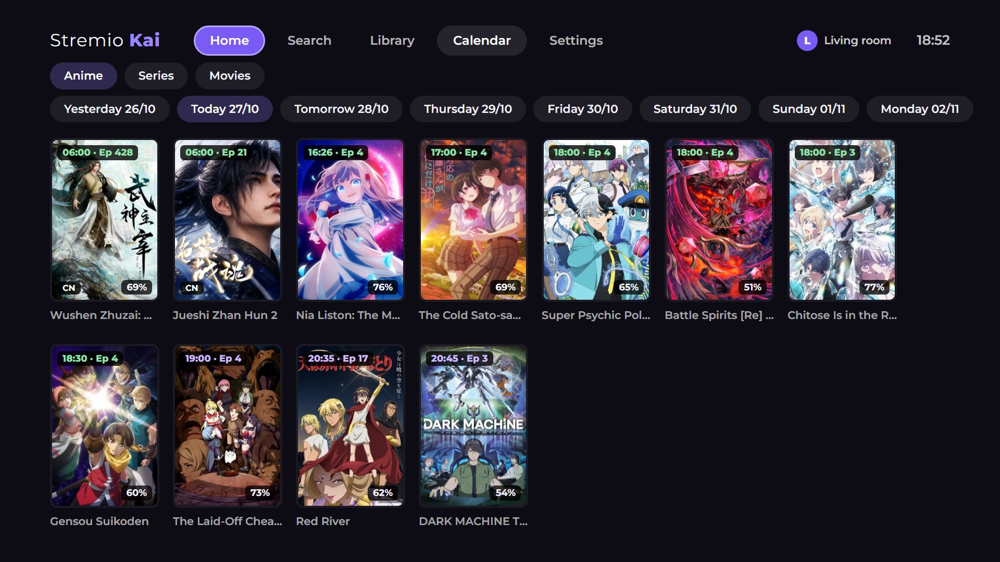 | 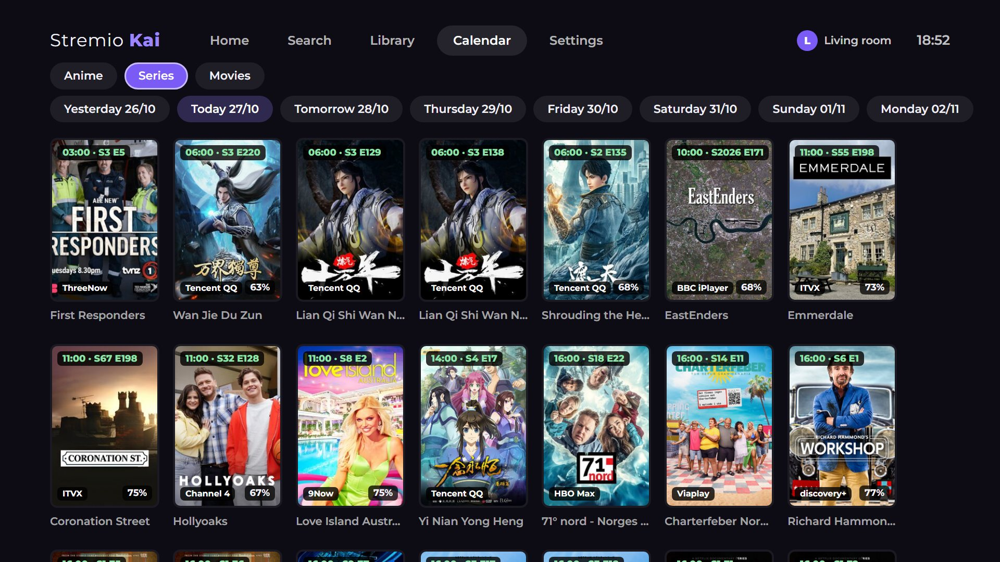 |

#### English and Arabic
The whole app in **English** or **Arabic** (Settings → Language / اللغة, or automatic from the
TV's language). Arabic switches to a right-to-left layout, while titles and synopses keep their
own direction.

| Home | Details |
|---|---|
| 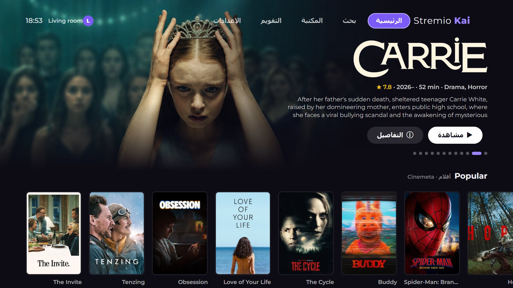 | 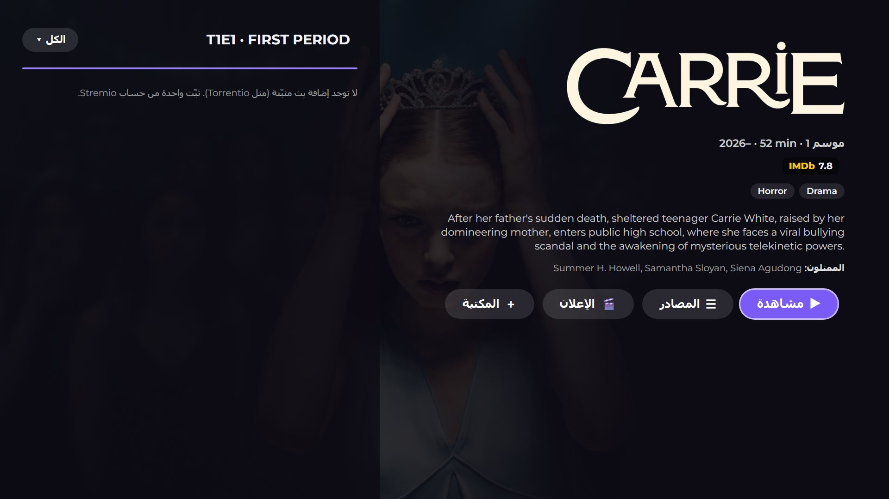 |

#### Profiles and settings
"Who's watching?" profiles, each on its own Stremio account, plus language, Smart Choice,
theme, subtitle and streaming-server settings, all usable with the remote.

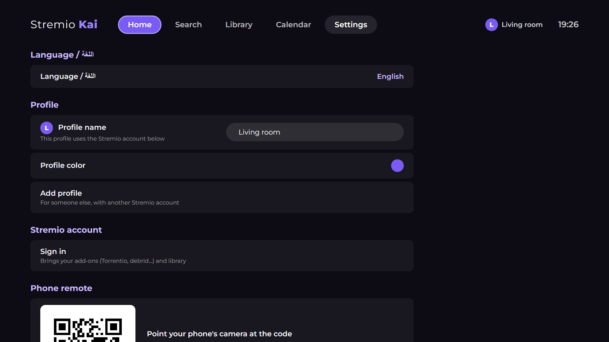

#### Trailers and actor profiles
- **Trailer** on every film and series page plays the official trailer full screen. Back closes
  it, OK pauses, and left/right switch between trailers when there are several.
- Select anyone in the **cast** to open their profile: photo, age, birthplace, biography, and all
  their films and series, each one a press away.
- With a free [TMDB](https://www.themoviedb.org/settings/api) key in Settings, descriptions,
  titles and biographies appear **in Arabic** when the app is in Arabic (English when TMDB has
  no Arabic text).


#### New episodes
A home-screen row with the episodes released in the last 7 days for the series in your library,
skipping the ones you've watched. Each opens straight on that episode.

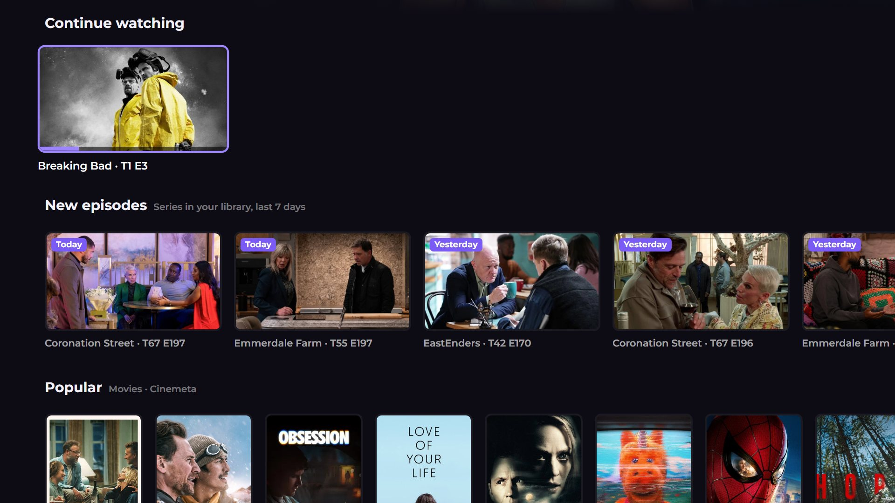

#### Watching
- **Skip intros automatically.** Intros and recaps are skipped on their own (IntroDB and
  AniSkip); at the credits the Up next card takes over. Settings → Skip intro can switch back to
  a button.
- **Watched markers.** Finished episodes get a ✓ and half-watched ones a progress bar.

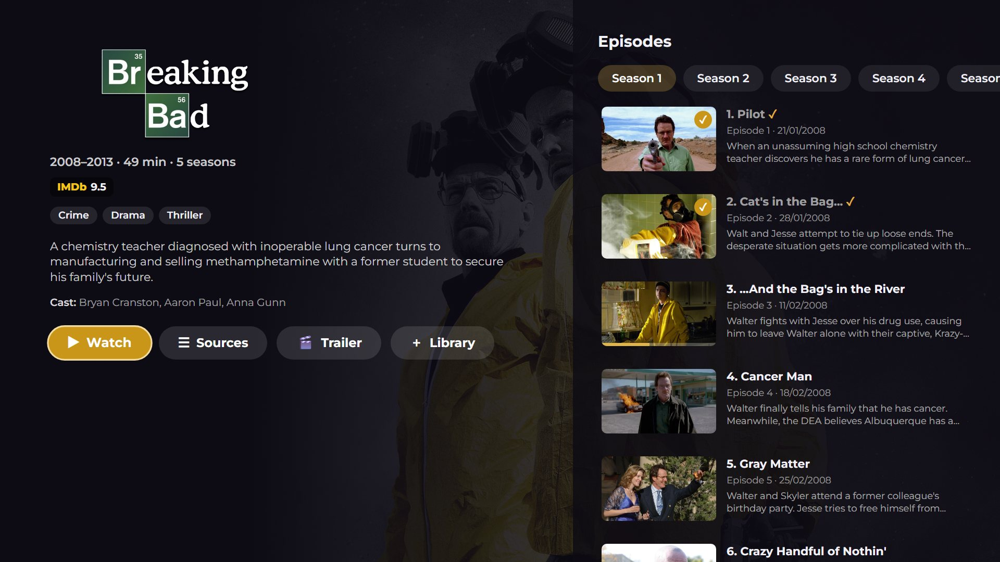

- **Up next.** Near the end of an episode (at the credits, when known) a card shows the next
  episode with a 10-second countdown: **Play now**, or **Cancel** / Back to stay.
- **Subtitle sync shortcut.** Subtitles out of time? While playing, press **Channel up/down**
  (or yellow/blue, or the phone remote's buttons) to move them later or earlier by 0.25 s. The
  setting is remembered for that episode or film.
- **Continue watching everywhere.** Progress syncs through your Stremio account: stop on the TV,
  carry on on your phone, PC or Fire TV, and the other way round.

#### Themes
Purple, gold, teal, red, blue or green: **Settings → Colour theme** recolours the whole app.

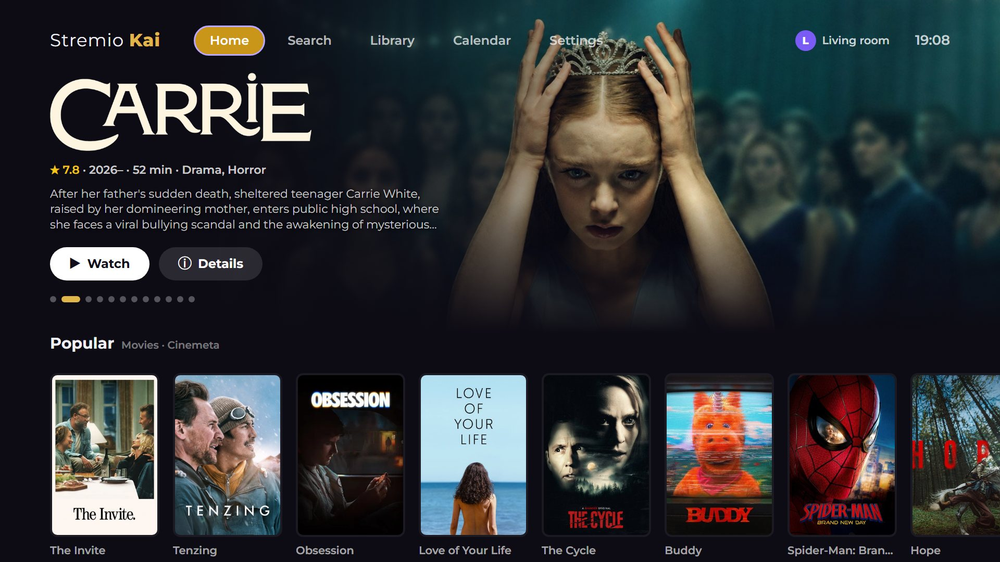

#### And more
- **Search by actor.** With a TMDB key, search shows matching actors and directors first; each
  opens their profile.
- **In-app updater.** Settings shows the installed and newest version; one press updates.
- **Your Stremio account.** Sign in with a code (on your phone at link.stremio.com) or by email.
  Add-ons, library and "Continue watching" come from your account, and progress syncs back.
- **Ratings.** IMDb out of the box; Rotten Tomatoes, Metacritic, Letterboxd and Trakt with a
  free [MDBList](https://mdblist.com) API key (Settings).
- **Smart source list.** Direct (debrid) links first, filter by add-on, and 4K, HDR,
  Dolby Vision and REMUX tags.
- **Player.** Uses the TV's hardware player (H.264, HEVC, HDR10), skips intros and outros
  (IntroDB and AniSkip), automatic subtitles, next episode on the same source, and reconnects
  if a video stalls.
- **Built for the Samsung remote.** Arrows, OK, Return, play/pause, fast-forward/rewind,
  colour and channel keys, and Samsung's on-screen keyboard. No pointer needed.
- **Light enough for old Tizen.** Plain JavaScript compiled down for the old web engine on
  Tizen 3.0 (Chromium 47); no WebAssembly required.

## Requirements

- A Samsung TV running **Tizen 3.0 or newer** (2017 onwards). Tested on a 2017 UA65MU8500 (Tizen 3.0).
- **TizenBrew** on the TV (installation steps below).
- For playback, **one** of:
  - a **debrid** service (Real-Debrid, AllDebrid, etc.) in your Stremio add-ons: plays directly
    on the TV, no PC needed;
  - torrent add-ons such as Torrentio or Comet: the app runs their torrent streams on the TV,
    without stremio-service on a PC.
- Links that only need request headers (Referer/User-Agent/Cookie) need neither: the app's
  TizenBrew service fetches them on the TV itself.

## Installing on a Samsung TV

You need a PC on the same Wi-Fi as the TV for steps 1 to 3. After that, the TV works on its own.

### 1. Turn on Developer Mode

1. Find your PC's IP address (on Windows: open Command Prompt and run `ipconfig`; look for
   **IPv4 Address**, e.g. `192.168.1.20`). The TV and PC must be on the same network.
2. On the TV, press **Home** and open **Apps**.
3. On the Apps screen, type **1 2 3 4 5** with the remote's number keys (or the on-screen
   keypad on remotes without numbers).
4. In the **Developer Mode** window, switch **Developer mode** to **On**, enter your PC's IP
   address under **Host PC IP**, and select **OK**.
5. **Restart the TV**: hold the remote's power button until the TV turns off and back on,
   or unplug it for 30 seconds. Developer Mode only starts after a full restart.

### 2. Download TizenBrew Installer

TizenBrew Installer is a small desktop app that puts TizenBrew on the TV.

1. On the PC, open the
   [TizenBrew Installer releases page](https://github.com/reisxd/TizenBrewInstaller/releases/latest).
2. Under **Assets**, download the file for your computer:

   | Computer | File |
   |---|---|
   | Windows | `TizenBrewInstaller-win-x64.exe` |
   | Mac (Apple Silicon, M1 or newer) | `TizenBrewInstaller-macos-arm64` |
   | Mac (Intel) | `TizenBrewInstaller-macos-x64` |
   | Linux | `TizenBrewInstaller-linux-x64` |

   Ignore `TizenBrewInstaller.wgt`, which is the TV version.
3. Run it:
   - **Windows:** double-click the `.exe`. If Windows SmartScreen says it "protected your PC",
     click **More info → Run anyway** (the installer isn't signed by Microsoft). If the firewall
     asks, allow it on **Private networks**.
   - **Mac / Linux:** open Terminal in the download folder, run
     `chmod +x TizenBrewInstaller-*`, then run the file (e.g. `./TizenBrewInstaller-macos-arm64`).
     On a Mac, if it's blocked, allow it in **System Settings → Privacy & Security**.

### 3. Install TizenBrew with the installer

1. Find the **TV's IP address**: on the TV, go to **Settings → General → Network →
   Network Status → IP Settings** and note the **IP Address** (e.g. `192.168.1.35`).
2. In TizenBrew Installer, type the TV's IP into the **TV IP** box and click **Connect to TV**.
   - *"Could not connect to the SDB Daemon"* means the TV is off, the IP is wrong, or the TV
     wasn't restarted after step 1.
3. Click **Install TizenBrew**. It shows *Fetching package → Installing package →
   Package installed*.
   - **Tizen 7 or newer (2023+ TVs):** it shows **Resigning required**. Click
     **Sign in to Samsung Account**, sign in, and follow its steps so it can sign TizenBrew
     for your TV. Older TVs skip this.
4. **TizenBrew** now appears in the TV's **Apps**. You can close the installer.

See the [TizenBrew install guide](https://github.com/reisxd/TizenBrew/blob/main/docs/README.md)
for other install methods.

### 4. Point Developer Mode at the TV itself

TizenBrew needs this to run:

1. On the TV, open **Apps** and type **1 2 3 4 5** again.
2. Keep **Developer mode** **On**, change **Host PC IP** to **127.0.0.1**, and select **OK**.
3. Restart the TV again.

Leave Developer Mode on from now on, or TizenBrew won't open.

### 5. Add Stremio Kai

1. Open **TizenBrew** and go to **Module Manager → Add module**.
2. Choose **GitHub** (not NPM) and enter:
   ```
   FeridunDuran/stremio-kai-tizen
   ```
3. **Stremio Kai** now appears in TizenBrew. Open it.

### 6. First launch

1. The setup explains that torrent playback runs on the TV and does not need a PC server.
2. Sign in to your Stremio account: go to **link.stremio.com** on your phone and enter the code
   shown on the TV, or sign in with email.
3. Your add-ons and library load from your account. Pick something and play.

**Updating:** the app loads the newest commit of this repository each time it starts, so a full
restart is enough. Samsung keeps apps running in the background: if a new version doesn't show
up, hold the remote's power button until the TV restarts. **Settings → Updates** shows the
installed and newest version and can update from there too.

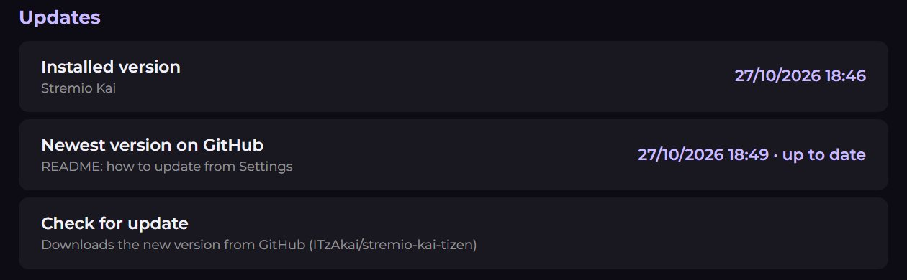

### Troubleshooting

- **TizenBrew won't open:** check that Developer Mode is still **On** with Host PC IP
  **127.0.0.1**. A TV firmware update or factory reset turns it off.
- **The installer can't find the TV:** make sure the Host PC IP in step 1 is the PC's current IP,
  the TV was restarted afterwards, and both are on the same network (not a guest network).
- **A video won't play:** try a debrid (direct) source, or check that the TV torrent player is
  ready for torrent sources. Header links should be tagged **Via TV**; if they say
  **Direct · may fail**, neither the TV header proxy nor the PC proxy was detected. The app
  tries to start its own loopback proxy using the same commit as the running app, even when
  TizenBrew has an older phone service cached. HTTP sources stop waiting after 120 seconds;
  Smart Choice then tries its next backup.
- **Audio track language is missing:** “Audio track N (language not provided)” means the
  source did not label the language; it does not mean that the file contains no sound.
  TizenBrew HLS playback uses a bundled HLS.js player through MediaSource. It reports multiplexed audio codecs and supports alternate audio tracks when provided. Installed Samsung apps can use AVPlay when available.
  Silent or unsupported source audio cannot be repaired by adding request headers alone.
- **Few or no sources:** torrents are hidden while the TV torrent player is unavailable; each
  add-on shows how many were hidden. Header links are no longer hidden.
- **The Library tab or a new feature doesn't appear:** the TV is still running the old version;
  restart it fully (see Updating).

## Tizen integration

- Samsung **Return**, media, colour and channel keys, registered through the Tizen
  TVInputDevice API.
- Exits through the Tizen application API.
- Finds the TV's IP address (to scan the network for stremio-service) through Samsung's
  network API, with a WebRTC fallback.
- Shows the TV model in Settings through Samsung's product info API.
- Updates itself: a small loader asks GitHub for this repository's newest commit and loads that
  build from jsDelivr, falling back to the copy TizenBrew installed.

## Known limitations

- **Playback on TizenBrew** uses HLS.js for HLS and DASH.js for MPEG-DASH streams when MediaSource is available;
  TizenBrew module pages do not have packaged-app AVPlay privileges. Other HTTP files
  keep using HTML video. Real PenguPlay VidFast vRapid/vBlaze streams were tested through
  the shipped proxy in desktop Chrome, including video/audio decoding, seek and source
  switching. Q70T hardware verification is still outstanding. Embedded subtitle switching through Samsung's
  API is not implemented; add-on subtitles still use the app's renderer.
- The AI enhancements of the PC version of Stremio Kai (SVP, VapourSynth, Anime4K) are not
  included: TVs can't run them.

## Building

Needs Node.js.

```
npm install
npm run build
```

The built app is written to `dist/`, which TizenBrew loads (`appPath` in `package.json`).
Commit `dist/` together with the source: the TV runs the built files straight from GitHub.

### Syncing with upstream

```
git remote add upstream https://github.com/ITzAkai/kai
git fetch upstream
git merge upstream/main
npm run build
```

Keep `REPO` in `src/static/loader.js` and `src/js/api/update.js` pointing to
`FeridunDuran/stremio-kai-tizen`, otherwise the TV loads upstream's code instead of this fork.

## Credits

- [Stremio Kai](https://github.com/allecsc/Stremio-Kai) by allecsc: the original design and features.
- [Stremio Kai Timeworn](https://github.com/creachec/Stremio-Kai-Timeworn) by binhoc: the
  lightweight TV build this Tizen version is based on.
- [ITzAkai/kai](https://github.com/ITzAkai/kai): the Tizen port this fork follows.
- [TizenBrew](https://github.com/reisxd/TizenBrew) by reisxd: runs this app on Samsung TVs.
- [stremio-core](https://github.com/Stremio/stremio-core): the Continue watching rules.
- [Stremio](https://www.stremio.com/).

## License

[GPL-3.0](LICENSE), the same as the projects it is based on.

MovieBoxProviderIN DASH links require the DASH player as well as the header proxy.
A server type of `application/octet-stream` does not identify the media codec.
The MovieBox HEVC/AAC DASH source was verified in desktop Chrome with the TV proxy
code, including audio/video decoding. Q70T hardware verification remains pending.
